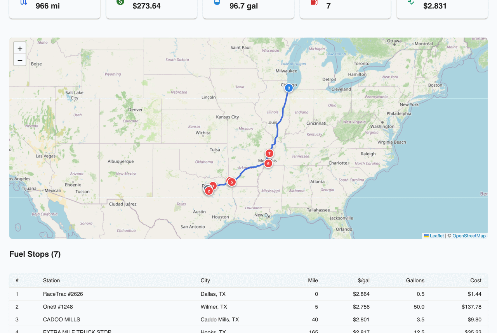
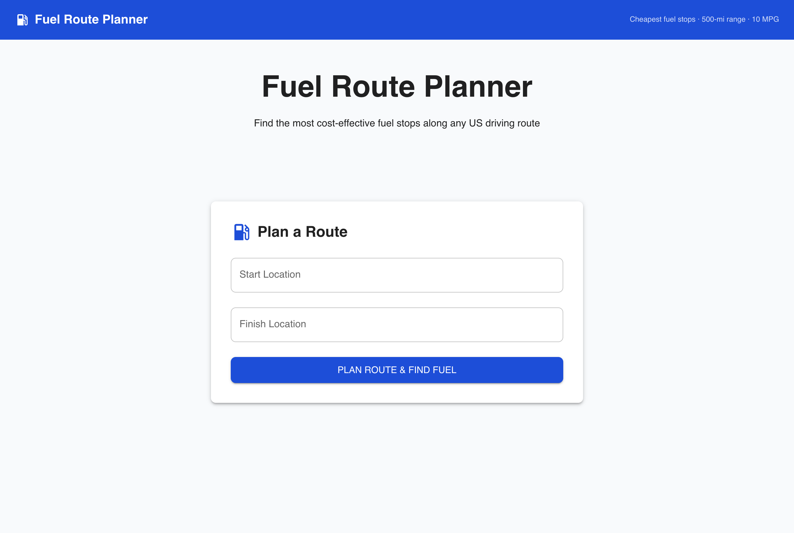
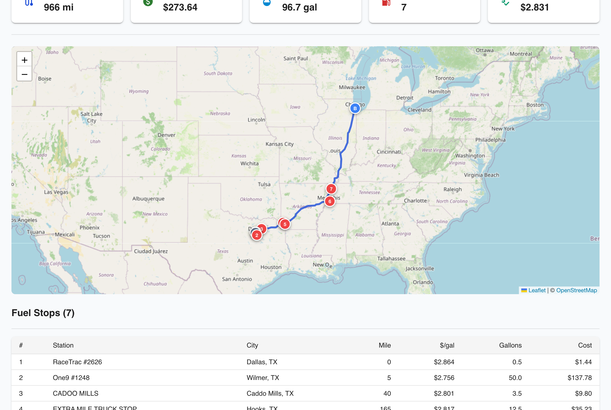
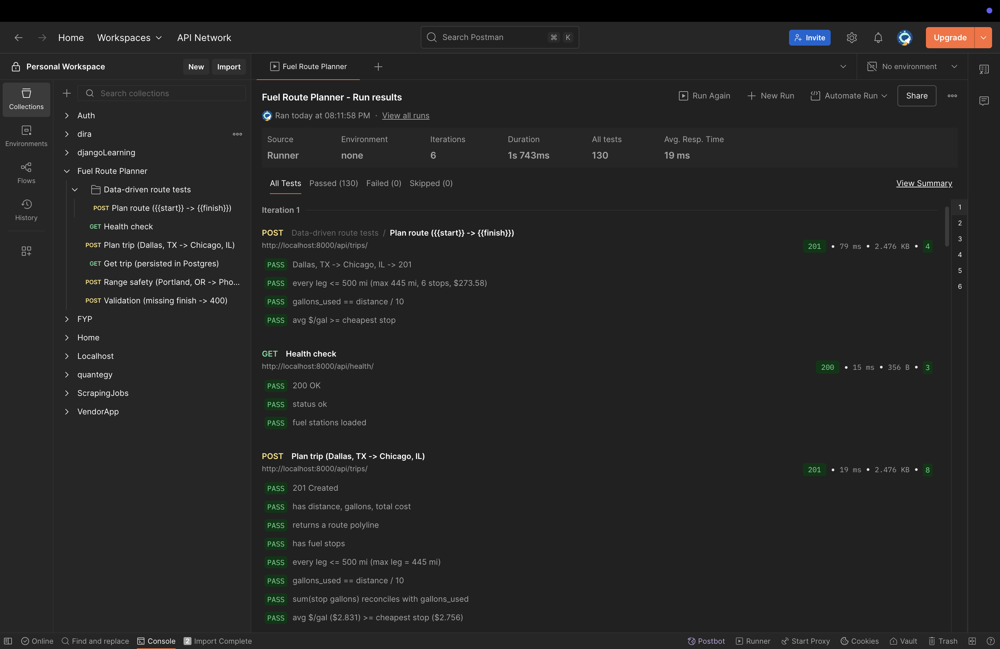

# Fuel Route Planner

Given a start and finish in the USA, returns the driving route, the most cost-effective fuel stops along it (cheapest fuel, 500-mile tank range), and the total fuel cost at 10 MPG.

## Demo



Caption: real capture of the running app (Dallas, TX to Chicago, IL: route, 7 fuel stops, total cost).


- Live: run locally with `make setup && make run`, then open http://localhost:5173
- Video walkthrough: [docs/screenshots/demo.mp4](./docs/screenshots/demo.mp4)
- Screenshots: [./docs/screenshots/](./docs/screenshots/)

| Home | Route + fuel stops |
|------|--------------------|
|  |  |

### API tests (Postman)

The [Postman collection](./docs/fuel-route-planner.postman_collection.json) + [data file](./docs/fuel-route-planner.postman_data.json) run **130 assertions across 6 routes** — every leg ≤ 500 mi, `gallons_used == distance / 10`, and average price ≥ the cheapest stop — all passing.



```bash
# functional suite
newman run docs/fuel-route-planner.postman_collection.json
# data-driven route tests
newman run docs/fuel-route-planner.postman_collection.json \
  --folder "Data-driven route tests" -d docs/fuel-route-planner.postman_data.json
```

## Features

- [x] Cost-optimal fuel stops (cheapest fuel via the "gas station" greedy)
- [x] 500-mile tank range enforced — multiple fuel-ups shown when needed
- [x] Total fuel cost at 10 MPG, with per-stop gallons + price
- [x] Interactive route map (Leaflet + OpenStreetMap) with numbered stops
- [x] One routing API call per request (OSRM); 6,600+ stations pre-geocoded offline → zero geocoding calls at runtime
- [x] Trips persisted in PostgreSQL
- [ ] User accounts / saved trips (not required)

## Local Setup

Everything runs in Docker (PostgreSQL + Django + React) — no local Python/Node needed. No API keys required.

### macOS
```bash
brew install --cask docker   # or: brew install colima docker && colima start
make setup && make run
```

### Linux
```bash
sudo apt install docker.io docker-compose-plugin make
make setup && make run
```

### Windows (WSL2)
Follow the Linux instructions inside WSL2 (with Docker Desktop's WSL2 backend enabled).

Then open:
- Frontend — http://localhost:5173
- API — http://localhost:8000/api/
- Admin — http://localhost:8000/admin/

### API

`POST /api/trips/` → `{ "start": "Dallas, TX", "finish": "Chicago, IL" }` returns distance, `gallons_used`, `total_fuel_cost`, the `route_geometry` polyline, and ordered `fuel_stops`. `GET /api/trips/{id}/` retrieves a saved trip; `GET /api/health/` reports status + station count.

## Test Coverage

```
make test
# 13 tests, OK
# coverage: 77% overall — core fuel_service.py 98%
```

Covers the fuel greedy (optimality, 500-mi range, full-consumption accounting, infeasible gaps), corridor station-matching, and route-geometry helpers.

## Deployment Dependencies

- Docker + Docker Compose
- PostgreSQL 15+
- Python 3.12+ (backend)
- Node 20+ (frontend build)
- Routing: OSRM public server (free, no key) — override `OSRM_BASE` / `NOMINATIM_BASE` to self-hosted instances for production
- Env vars: see [.env.example](./.env.example)

## Regenerating station data

The OPIS price CSV has only City/State. `scripts/geocode_stations.py` maps each city to a centroid offline via `pgeocode` (no geocoding API) and writes the committed `backend/api/data/stations.json`, which `manage.py load_stations` loads into Postgres.

```bash
cd backend && uv run --group build python scripts/geocode_stations.py
```

## License

MIT, see [LICENSE](LICENSE).
